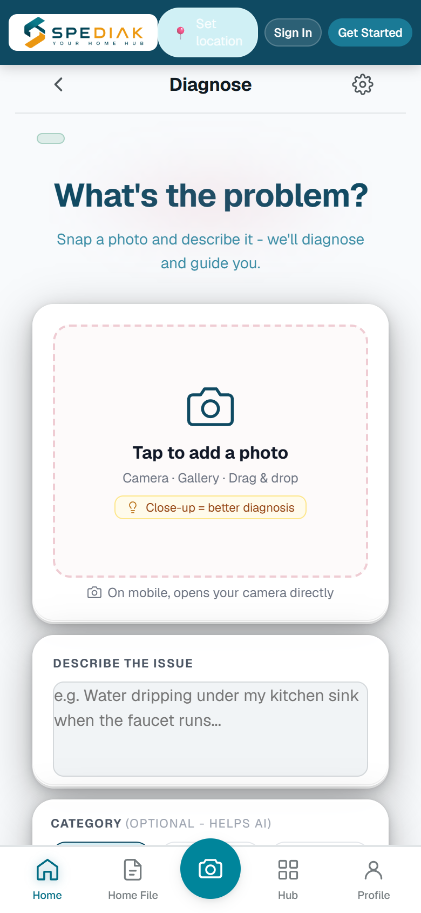
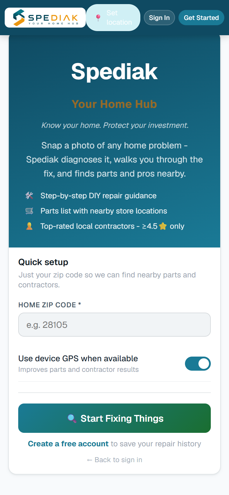

# Feature tour

The two available captures show the later web/Capacitor client. The earlier Expo implementation is identified separately.

[Overview](README.md) · [Capture provenance](SCREENSHOTS.md)

[Later client interface](#later-client-interface)

## Later client interface

### Inspection photo and notes

Choose inspection media and add observations in the analysis input view.

*Archived later web/Capacitor client; English/light, guest and empty-input state.*

### Consumer setup

Inspect the consumer setup flow before using the client.

*Archived later web/Capacitor client; English/light, guest state.*

## Coverage and implementation notes

| Earlier Expo client function | Public visual coverage |
| --- | --- |
| Photo capture/selection and written notes | The later client input is pictured; it is not a screenshot of the earlier Expo implementation. |
| Voice transcription | Described in [Engineering](ENGINEERING.md); no transcription result capture is available in this case. |
| Draft generation and editing | Described in [Engineering](ENGINEERING.md); no generated diagnosis or edited statement is pictured. |
| Authentication and inspection history | Earlier client integration work; no private account or inspection-history capture is published. |

These are the two authentic later-client captures retained in this case. Separate HTML design-handoff screens are excluded from the gallery. Backend success and store release are not established by these images.

[Back to overview](README.md)
