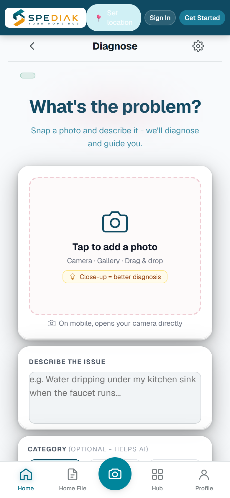
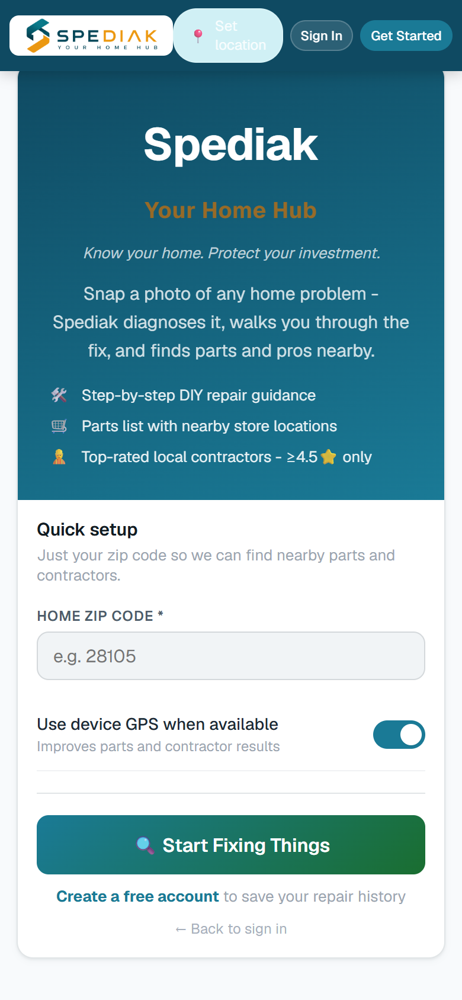

# Spediak

**A mobile/web inspection client for turning photos and notes into editable draft statements.**

[Engineering](ENGINEERING.md) · [Contact](https://github.com/excelenciaempire/riverz-showcase/issues/new?title=Professional%20inquiry)

## Earlier React Native/Expo client workflow

1. Capture or select an inspection photo.
2. Add written notes or transcribe spoken observations.
3. Generate a draft statement.
4. Review and edit the result; the client also requests that it be saved to inspection history.

## Later web/Capacitor phase

The project also has a later HTML/JavaScript client wrapped with Capacitor for web, iOS and Android. Its implementation is maintained separately from the earlier Expo repository. The captures below come from that later application’s local audit. They document the client interface; this case does not claim original authorship of Capacitor, third-party services or independently verified operation of every backend integration.

## Inside the application

### Photo and notes input

Archived local web/Capacitor application capture; native English/light interface and guest/empty input state. This is the later client phase, separate from the earlier Expo client.

### Consumer setup

Archived local web/Capacitor application capture; native English/light interface and guest/empty input state. This is the later client phase, separate from the earlier Expo client.

[Capture provenance](SCREENSHOTS.md)

## My contribution

My earlier-phase work is the React Native/Expo client: media input, transcription state, statement-generation requests, result editing, authentication and history integration. This case focuses on that client rather than claiming all backend behavior.

In that Expo client, the main action generates the statement directly from the photo and notes. The generated text requires professional review; it is a draft, not a certified inspection finding.

**Earlier phase:** React Native · Expo · TypeScript · Clerk · Media capture · API integration

**Later client phase:** HTML/JavaScript · Capacitor · Web/iOS/Android shells

**All my development work presented here was done with AI assistance.** I use programming and software engineering fundamentals to define requirements, review code, test behavior and take responsibility for technical decisions.

This case is based on the client implementation. It does not establish a current store release or a verified live backend. Application source and inspection data stay private.
